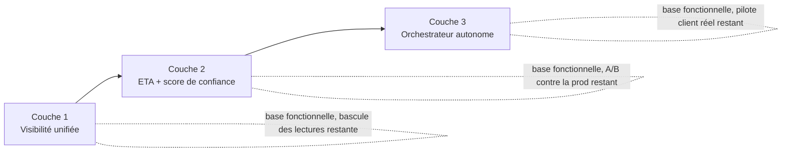

# Praxio (working name) — de la visibilité à l'action

> Plateforme d'orchestration modulaire ("Hubs") pour le commerce international et la logistique — née de la fusion de deux produits existants : [IncoKalk](https://github.com/Ybarzan/Incokalk) (conformité douanière, Incoterms, transporteurs internationaux) et [fleet-hub](https://github.com/Ybarzan/fleet-hub) (gestion de flotte poids lourds, GPS, tachygraphe). Ce dépôt est le nouveau monorepo cible ; les deux dépôts d'origine restent les sources de vérité historiques tant que la bascule n'est pas actée.

## Structure du dépôt

```
SaasModduleOS/
├── docs/                        # Stratégie, architecture, plan de migration (voir sommaire ci-dessous)
├── hubs/
│   ├── compliance-engine/       # ex-IncoKalk : douane, Incoterms, ETA, transporteurs internationaux, ERP
│   ├── fleet-hub/                # ex-fleet-hub : flotte poids lourds, GPS, tachygraphe, dernier kilomètre
│   ├── logistix/                 # Entrepôt / réception, intégré à fleet-hub via API
│   ├── finance/                  # Trésorerie, facturation client, reporting carbone/CSRD
│   └── portal/                   # Praxio : tableau de bord cross-hub, relais SSO, facturation groupée
├── docker-up.ps1 / docker-down.ps1   # Orchestration Docker locale des 5 hubs (voir leur -Hubs/-InfraOnly)
└── README.md
```

Chaque hub garde sa propre stack, son propre backend et sa propre base de données — voir [docs/07-integration-fleet-hub.md](docs/07-integration-fleet-hub.md) pour le choix explicite de **ne pas** fusionner les backends en un seul monolithe, et comment ils se parlent via API/webhook (jamais de lecture JPA cross-domain directe) en s'appuyant sur l'orchestrateur de la Couche 3.

**Note sur la copie de code** : `hubs/compliance-engine` et `hubs/fleet-hub` sont des copies de l'état initial des dépôts sources (23/08/2026), sans historique git préservé au-delà de ce point — l'historique antérieur reste consultable dans les dépôts d'origine. Tout le travail depuis cette date (voir Statut ci-dessous) vit uniquement dans ce monorepo. `logistix`, `finance` et `portal` ont été créés directement ici, sans dépôt d'origine.

## Le pitch

> *« Vos systèmes savent déjà qu'une expédition va être en retard. Praxio agit avant que ça devienne votre problème — réajuste la commande fournisseur, réalloue le stock, prévient le client — sans que vous ayez à ouvrir cinq écrans différents. »*

**Fermer l'écart entre savoir et faire — pour le commerce international.**

## Le constat de départ

L'audit du code existant (voir [docs/01-audit-existant.md](docs/01-audit-existant.md)) montre un socle plus mature qu'attendu : connecteurs transporteurs (DHL, MSC, CMA CGM, Geodis, DB Schenker), ERP bidirectionnel (Odoo, SAP B1), et un moteur ETA prédictif avec score de confiance déjà en production. Ce qui manque n'est pas la donnée — c'est la couche d'action : aucun moteur de règles conditionnelles au-delà d'un filtrage simple, aucun bus d'événements, aucune écriture automatique déclenchée par un événement métier. C'est précisément ce que cette refonte construit.

## Sommaire des livrables

| Document | Contenu |
|---|---|
| [docs/01-audit-existant.md](docs/01-audit-existant.md) | Audit factuel du code actuel, couche par couche, avec preuves (fichiers/services) |
| [docs/02-architecture-cible.md](docs/02-architecture-cible.md) | Architecture cible à 3 couches, diagrammes, composants, flux de données |
| [docs/03-plan-migration.md](docs/03-plan-migration.md) | Plan de migration en 3 phases avec jalons et Gantt indicatif |
| [docs/04-composants-techniques.md](docs/04-composants-techniques.md) | Détail de chaque nouveau composant technique, complexité relative |
| [docs/05-estimation-couts-risques.md](docs/05-estimation-couts-risques.md) | Estimation d'effort (2 lectures : cadence réelle vs semaines-personnes classiques) et risques par ordre d'impact |
| [docs/06-positionnement-gtm.md](docs/06-positionnement-gtm.md) | Nouveau pitch, propositions de nom, segmentation tarifaire, stratégie de mise sur le marché |
| [docs/07-integration-fleet-hub.md](docs/07-integration-fleet-hub.md) | Pourquoi et comment intégrer fleet-hub comme un Hub à part entière (architecture, pas fusion de code) |
| [docs/08-refonte-frontend.md](docs/08-refonte-frontend.md) | Scope réaliste et priorisation de la refonte frontend (nouveau design system, unification des deux apps) |
| [docs/09-design-system.md](docs/09-design-system.md) | Système de design actuel (v0.3) : palette, typographie, layout — [aperçu visuel](https://claude.ai/artifact/QXVtg1hzVGBcGH3yuGTVTW), déployé sur les 5 hubs |

## Architecture cible en un coup d'œil



Détail complet dans [docs/02-architecture-cible.md](docs/02-architecture-cible.md).

## Principes qui contraignent chaque décision technique

- **API-first** — chaque nouveau composant expose une API avant toute UI
- **No-code pour l'utilisateur** — configuration des règles en langage naturel, jamais d'exécution de texte libre non validé
- **Cohabiter, pas remplacer** — les adaptateurs transporteurs/ERP/e-commerce existants restent l'unique point de contact avec les systèmes tiers
- **Modulaire** — chaque couche est vendable et déployable indépendamment
- **Gouvernance stricte** — toute action orchestrée reste dans un cadre défini par l'utilisateur (budget, transporteurs autorisés, seuil de validation humaine), bloquant à l'exécution et pas seulement déclaratif

## Statut (mis à jour le 31/10/2026)

- **Fait (23/08/2026)** : audit, architecture cible, plan de migration, estimation, positionnement, copie des deux codebases (compliance-engine + fleet-hub) dans ce monorepo.
- **Fait depuis** : les 3 couches du plan de migration ont une base fonctionnelle — event store d'audit (fleet-hub), scoring ETA multi-source avec fiabilité mesurée, moteur de règles + gouvernance + constructeur visuel, exécuteur d'actions (Odoo/QuickBooks), configuration de règles en langage naturel (validation humaine obligatoire), write-back e-commerce (Shopify quasi complet, WooCommerce fait). Domaine Transport extrait de compliance-engine vers fleet-hub (12/10/2026). Trois nouveaux hubs créés et intégrés par API : `logistix` (entrepôt/réception), `finance` (trésorerie/facturation), `portal` (tableau de bord cross-hub Praxio). Design system v0.3 déployé sur les 5 hubs (voir [docs/09-design-system.md](docs/09-design-system.md)). Classification douane opérationnelle (31/10/2026) : les correctifs P0 de l'audit du 2026-09-29 (calcul de droits jusqu'à 84% affiché au lieu de ~1,8% réel, EORI cassé, taux simulés persistés comme réels) sont mergés et revalidés contre `main` actuel — un taux non trouvé en base est désormais explicitement signalé comme indisponible côté API et UI, jamais une approximation silencieuse.
- **Pas encore fait** : bascule des lectures dashboard/portail vers l'event store (Phase 1 J5-J6, nécessite sa propre décision) ; pilote avec des clients réels (Phase 3 J11-J13) ; A/B du scoring ETA contre des données de production réelles ; intégrations PrestaShop et SAP ; le frontend n'a pas été intégralement redessiné au-delà du design system (scope dans [docs/08-refonte-frontend.md](docs/08-refonte-frontend.md)) ; aucun renommage `com.incokalk`/`com.fleethub` → `com.praxio` n'a été fait dans le code (changement mécanique risqué, à traiter comme un chantier dédié avec vérification complète des tests, pas en même temps qu'une copie de fichiers).
- Les dépôts d'origine [Ybarzan/Incokalk](https://github.com/Ybarzan/Incokalk) et [Ybarzan/fleet-hub](https://github.com/Ybarzan/fleet-hub) ne reçoivent plus les évolutions : tout le développement actif se fait désormais dans ce monorepo.
