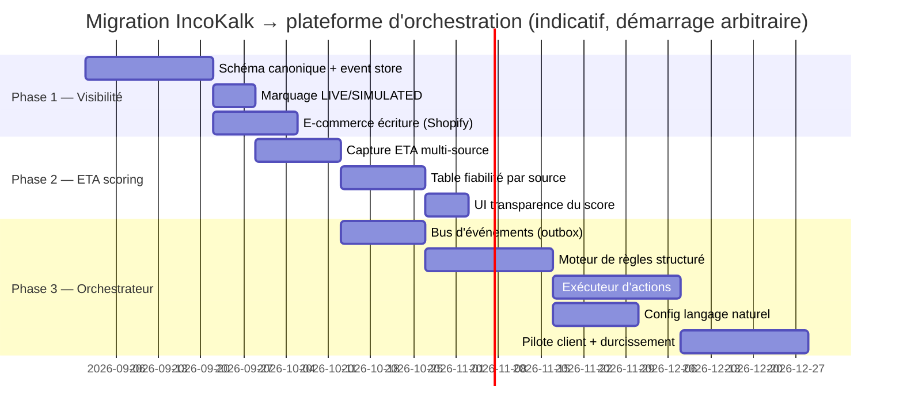

# Plan de migration en 3 phases

> Hypothèse de calibrage : équipe actuelle (1-2 développeurs full-stack + IA en pair-programming, cadence observée sur l'historique de commits IncoKalk). Les durées sont en semaines-calendaires à cette cadence, pas en semaines-personnes classiques de cabinet de conseil — voir [05-estimation-couts-risques.md](05-estimation-couts-risques.md) pour la conversion et un scénario à effectif renforcé.

---

## Phase 1 — Mise à niveau de la couche de visibilité (6 semaines)

**Objectif** : passer d'adaptateurs qui alimentent directement les tables métier à un event store canonique, sans casser aucune fonctionnalité existante.

| Jalon | Livrable | Critère de sortie |
|---|---|---|
| J1 | Schéma `ShipmentEvent` défini + table event store (partitionnée `company_id`) | Migration Flyway V60 revue, ADR (Architecture Decision Record) validé — **ADR fait et scope révisé 2026-10-29** (`docs/adr/0001-event-store-canonique.md`) : ce jalon a été écrit avant le retrait du domaine Transport de compliance-engine (commit `dc1e04d`), à une époque où tous les adaptateurs producteurs vivaient dans un seul hub — l'ADR documente pourquoi ce n'est plus le cas et pourquoi `event_outbox` (V63, J1-J2 de Phase 3) n'est pas un event store (file de livraison transitoire, pas un historique permanent). Décision : Option C (fédérée) — un event store local **fleet-hub seulement** pour ce chantier, pas de store global cross-hub tant qu'aucun besoin réel ne l'exige, pas de partitionnement Postgres (aucune preuve de volume qui le justifie). Schéma réel : table `shipment_events` (fleet-hub, V18), non partitionnée. |
| J2 | Les 5 `CarrierAdapter` + 2 `ErpProvider` + `ShopifyAdapter` publient dans l'event store en plus de leur comportement actuel (double écriture) | Tests de non-régression backend verts, aucun endpoint existant modifié — **fait 2026-10-29 pour le périmètre retenu par l'ADR** (fleet-hub seul, voir J1) : `ShipmentEventRecorder` journalise désormais, en plus du comportement existant inchangé, `SHIPMENT_CREATED` (`ShipmentService.createShipment`), `STATUS_CHANGED` manuel et webhook (`updateStatus`/`processWebhookEvent`), `VESSEL_ASSIGNED` (`assignVessel`) et `ETA_CAPTURED` (`CarrierBookingService.recordEtaReportedSource`, `AisEtaCaptureService.upsert`). Un échec d'écriture est journalisé et ignoré, jamais propagé (même principe que `recordEtaReportedSource`) — aucune des opérations métier existantes ne peut échouer à cause de ce chantier. Les 2 `ErpProvider` et `ShopifyAdapter` (compliance-engine) ne sont **pas** concernés : hors scope de l'Option C retenue, qui exclut délibérément tout event store compliance-engine ou cross-hub pour l'instant. Tous les tests backend fleet-hub existants restent verts (0 régression), aucun endpoint modifié. |
| J3 | Flag `dataSource: LIVE\|SIMULATED` propagé jusqu'au frontend | Le badge est visible sur `ShipTracker.tsx` et toute vue tracking — **fait, mais côté fleet-hub** : le domaine transport (réservations transporteur, tracking) a été déplacé de compliance-engine vers fleet-hub (migration `V75__drop_transport_domain.sql`) après l'écriture de ce plan, ce qui explique l'absence de `ShipTracker.tsx` dans compliance-engine aujourd'hui. `CarrierBookingRequest.simulated` et `TrackingEvent.dataSource` sont correctement remplis côté backend fleet-hub et affichés (`CarrierBookings.jsx`, `Shipments.jsx`, `ClientShipmentDetail.jsx`). **Complément 2026-10-29** : `autoSyncInTransitShipments()` (le job qui alimentait automatiquement ce flag LIVE) avait été retirée avec le domaine Transport, laissant la synchronisation purement manuelle (`POST /api/tracking/shipments/{id}/sync`) depuis. Restaurée côté fleet-hub (`AutoTrackingSyncService`, même capacité, nouveau propriétaire des données) mais **désactivée par défaut** (`fleethub.tracking.auto-sync.enabled=false`) : contrairement aux autres restaurations de ce type, celle-ci déclenche des appels automatiques vers des API tierces potentiellement facturées (Ship24/AviationStack/AIS) pour chaque société ayant déjà configuré une clé -- l'activer sans contrôle changerait silencieusement la consommation de quota/coût des clients existants. À activer consciemment par déploiement après vérification des quotas. |
| J4 | `ECommerceAdapter.pushOrderStatus/pushEta` implémenté pour Shopify | Un changement de statut IncoKalk se reflète dans Shopify sous 5 min — **partiellement fait 2026-10-28** : `ShopifyAdapter.markOrderShipped()` (création de fulfillment via le flux `fulfillment_orders` → `POST /fulfillments.json`, vérifié sur la doc officielle Shopify) et `pushEta()` (ETA en metafield `incokalk/eta`) sont implémentés et exposés manuellement (`POST /v1/ecommerce/integrations/{id}/orders/{externalOrderId}/mark-shipped` et `.../eta`), WooCommerce/PrestaShop renvoient un échec explicite (non implémentés). **Déclenchement automatique fait 2026-10-29**, scope volontairement plus étroit que la boucle complète (voir pourquoi ci-dessous) : table `ecommerce_shipment_links` (V81, corrélation manuelle `integration_id`/`external_order_id` ↔ `fleethub_shipment_id`, créée via `POST .../orders/{externalOrderId}/link`) -- `EcommerceShipmentLinkService.link()` **vérifie que l'expédition existe réellement côté fleet-hub** via `FleetHubIntegrationClient.getShipmentSummary` avant d'enregistrer, jamais un lien vers un UUID non vérifié. `EventOutboxProcessor.handleShipmentStatusChange()` appelle désormais automatiquement `markOrderShipped()` dès que fleet-hub signale le passage en `IN_TRANSIT` pour une expédition liée (premier signal réel de départ), sans numéro de tracking/transporteur (non porté par ce webhook -- `ShopifyAdapter` gère déjà leur absence) ; un échec du push est journalisé et jamais propagé (ne doit pas faire rejouer tout l'événement outbox, qui ré-enverrait la notification déjà traitée). **Création automatique de `ShipmentOrder` depuis une commande entrante faite 2026-10-29 pour Shopify** (ADR-0002, `docs/adr/0002-creation-expedition-externe.md`) : l'endpoint d'écriture fleet-hub manquant (identifié ci-dessus comme blocage) existe désormais (`POST /api/internal/shipments`, opt-in séparé `allowExternalShipmentCreation`, toujours `DRAFT`). `ECommerceSyncService.syncSingleIntegration()` n'est plus un no-op : chaque commande non encore liée (idempotence via `ecommerce_shipment_links`) est mappée par `adapter.mapOrderToShipment()` puis créée via `FleetHubIntegrationClient.createShipmentFromExternalSource`. **Shopify implémenté** (`shipping_address`/`line_items`/`total_weight`, champs corroborés par des exemples de réponses réelles -- shopify.dev inaccessible depuis cet environnement au moment de l'écriture, contrairement à `markOrderShipped` vérifié directement dessus) ; **WooCommerce/PrestaShop renvoient `Optional.empty()` (non implémentés)**, même discipline que `markOrderShipped`/`pushEta` sur ces deux plateformes -- adresse de livraison non vérifiée pour l'une (`shipping`, WooCommerce), ressource séparée non vérifiée pour l'autre (`addresses`, PrestaShop). `EmailIntakeService.autoCreateDraftShipment()` reste volontairement un no-op : contrairement à une commande e-commerce, un email entrant ne capture qu'une ville d'origine/destination en texte libre (regex), jamais un nom de destinataire -- le nouvel endpoint fleet-hub exige `consigneeName` (même règle que la création manuelle), que rien dans le modèle `EmailIntake` ne permet de renseigner honnêtement aujourd'hui. La mise à jour de `shipment_status` (in_transit/delivered) et l'annulation de commande ne sont **pas** implémentées : l'API REST Admin Shopify est legacy depuis le 1er octobre 2024 (GraphQL imposé pour toute nouvelle app publique depuis le 1er avril 2025) et la forme exacte de ces deux appels n'a pas pu être vérifiée depuis cet environnement (shopify.dev inaccessible, sources communautaires contradictoires, et la doc officielle indique elle-même que `shipment_status` ne suit pas automatiquement un simple ajout de tracking) — volontairement non deviné plutôt que livré faux. |
| J5-J6 | Bascule des lectures existantes (dashboard, portail client) de la lecture directe des tables vers des projections issues de l'event store | Dashboard et portail client passent aux nouvelles projections, ancien chemin de lecture retiré |

**Ne pas faire en Phase 1** : ne pas toucher au moteur de règles ni à l'ETA — c'est une fondation de données, elle doit être invisible pour l'utilisateur final au démarrage (double écriture, bascule progressive).

---

## Phase 2 — Moteur ETA avec scoring (5 semaines)

**Objectif** : transformer le blend interne existant (Python/Java/heuristique) en agrégateur multi-source incluant les ETA réellement rapportés.

| Jalon | Livrable | Critère de sortie |
|---|---|---|
| J1-J2 | Capture systématique de l'ETA annoncé au booking (déjà dans `BookingResponse`, non persisté après coup) + ETA dérivé AIS | Table `eta_reported_sources`, alimentée à chaque booking et chaque cycle de polling AIS — **booking fait 2026-10-28** (fleet-hub, V14) : `CarrierBookingService.submitBooking()` capture `EtaReportedSource` (source `CARRIER_BOOKING`) à chaque réservation confirmée, lane/mode figés depuis `ShipmentOrder` au moment de l'observation. **ETA AIS fait 2026-10-28** (V16/V17) : une expédition peut désormais être liée à un navire suivi par MMSI (`ShipmentOrder.trackedVesselMmsi`, saisie manuelle -- rien ne permet de déduire automatiquement quel navire transporte quelle expédition), `AisStreamService` souscrit désormais aussi aux messages `ShipStaticData` (AIS type 5) et capte **l'ETA que le navire diffuse lui-même** (`getBroadcastEta()`) -- jamais une ETA calculée par distance/vitesse depuis la position (ce système n'a aucune table de coordonnées de port pour faire ce calcul honnêtement). `AisEtaCaptureService` (job périodique, 15 min) capture cette ETA pour chaque expédition suivie encore en cours, source `AIS_BROADCAST` -- une seule ligne par expédition, mise à jour avec la dernière ETA diffusée connue. `EtaSourceReliabilityService` mélange désormais CARRIER_BOOKING et AIS_BROADCAST dans une seule mesure par groupe transporteur×lane×mode -- pas de ventilation par source, qui demanderait aussi une politique de choix de source au moment de la prédiction (hors scope ici). |
| J3-J4 | Table `eta_source_reliability` (transporteur × lane × mode), calculée depuis l'écart historique réel (`TrackingEvent` vs `EtaPrediction` passées) | Job planifié hebdomadaire, historique d'au moins 4 semaines de données avant mise en production du poids calculé — **fait 2026-10-28** (fleet-hub, V15, `EtaSourceReliabilityService.recomputeWeekly()`, cron hebdomadaire lundi 3h) : recalcul complet (pas d'incrément) de l'écart moyen signé et absolu entre `EtaReportedSource.reportedArrival` et `ShipmentOrder.actualDeliveryDate`, groupé par transporteur × pays origine/destination × mode. Le seuil "4 semaines de données" est approximé par un nombre minimal d'échantillons (`MIN_RELIABILITY_SAMPLES = 20` dans `EtaPredictionService`, voir J5) — ce service ne connaît pas l'âge des observations, seulement leur nombre. |
| J5 | Agrégateur final : `confidencePercent` devient fonction du blend multi-source pondéré, pas uniquement du modèle ML interne | A/B interne : comparer l'ancien score vs le nouveau sur les 90 derniers jours d'expéditions clôturées, MAE mesurée — **mécanisme fait 2026-10-28**, **A/B non fait** (nécessite des données de production réelles, indisponibles dans cet environnement) : `EtaPredictionService.applyReliabilityWeighting()` pondère la confiance heuristique existante par la fiabilité mesurée dès que `sampleCount >= 20`, avec repli strict sur l'heuristique seule sinon (donnée insuffisante) ou si la prédiction n'est pas rattachée à une expédition réelle (`EtaPredictionController.predict` accepte désormais un `shipmentId` optionnel, jusque là silencieusement ignoré). La formule de blend est un point de départ raisonnable et borné comme l'heuristique existante, pas calibrée par l'A/B prévu ci-dessus — à mesurer une fois un historique de production disponible. |
| J6 | UI transparence du score (voir Gantt) : l'utilisateur doit pouvoir distinguer un score mesuré contre l'historique réel d'un simple repli heuristique | Le détail d'une prédiction ETA précise sa provenance — **fait 2026-10-29** : `EtaPredictions.jsx` affichait déjà un détail technique (baseline, saisonnier, congestion, douane, météo, facteurs de risque) mais sans jamais préciser si `applyReliabilityWeighting()` avait réellement pondéré par une mesure réelle ou était resté sur l'heuristique seule -- deux prédictions au même `confidencePercent` étaient indistinguables. Ajout de `reliabilityWeighted`/`reliabilitySampleCount` sur `EtaPrediction` (V19, renseignés uniquement sur le chemin où le blend mesuré s'applique réellement, jamais sur un repli) ; le panneau détail affiche désormais soit « Fiabilité mesurée sur N livraisons réelles » soit « Estimation heuristique — pas encore assez d'historique réel ». |

**Dépendance dure sur Phase 1** : l'agrégateur lit l'event store, pas les tables directement — Phase 2 ne peut pas commencer avant que J2 de Phase 1 soit stable (mais peut chevaucher J3-J6 de Phase 1, cf. Gantt).

---

## Phase 3 — Orchestrateur autonome (10-13 semaines, la plus lourde)

**Objectif** : fermer la boucle savoir → faire, en commençant par le cas d'usage à plus forte valeur perçue (réallocation stock ou ajustement fournisseur sur retard, à confirmer avec 2-3 clients pilotes avant de généraliser).

| Jalon | Livrable | Critère de sortie |
|---|---|---|
| J1-J2 | Bus d'événements (pattern outbox PostgreSQL + `ApplicationEventPublisher`) | Les événements ETA dégradé / statut changé transitent par le bus, `EventPublisher` actuel migré dessus sans régression notification — **`SHIPMENT_STATUS_CHANGE` fait 2026-08-23** (table `event_outbox` V63, `EventOutboxProcessor` planifié avec retry/abandon après 5 tentatives) ; **`SHIPMENT_CREATED` migré 2026-08-24**, même pattern (`ShipmentCreatedPayload`, écrit dans la même transaction que `ShipmentService.createShipment`). **Régression découverte et corrigée 2026-10-28** : le retrait du domaine Transport de compliance-engine (commit `dc1e04d`, 2026-10-12 -- voir [07-integration-fleet-hub.md](07-integration-fleet-hub.md)) a supprimé `ShipmentService`/`EventPublisher`, laissant `EventOutboxProcessor.dispatch()` sans aucun producteur pendant ~2 semaines (rejetait tout événement reçu). Rebranché via un nouveau webhook `fleet-hub -> compliance-engine` (`FleetHubEventWebhookController`, authentifié par clé hashée, opt-in par société) : `ShipmentEventPublisher` de fleet-hub (qui possède désormais `ShipmentOrder`/`TrackingEvent`) pousse ces deux événements en best-effort, `EventOutboxProcessor.dispatch()` les retraite avec les `eventType` historiques inchangés -- toute `NotificationRule` existante redevient fonctionnelle sans reconfiguration. `providerStatusChanged`/`quoteReceived` **volontairement laissés sur l'ancien chemin `@Async`** : audit du code (2026-08-24) confirme qu'ils n'ont aucun appelant réel aujourd'hui (`NotificationService.onProviderDown/onProviderRecovered/onQuoteReceived` existent mais rien ne les déclenche) — migrer de la plomberie autour de méthodes mortes n'aurait rien apporté ; à faire quand un vrai déclencheur (ex. health-check fournisseur) sera branché. **J1-J2 clos pour tout ce qui a un déclencheur réel aujourd'hui.** |
| J3-J5 | Moteur de règles structuré (condition composée → action candidate → contrainte de gouvernance) | Schéma de règle versionné, moteur d'évaluation testé sur 20+ scénarios de règles représentatifs — **fait 2026-08-23** : condition composée (`RuleConditionNode`/`RuleConditionEvaluator`, AND/OR/8 opérateurs, `NotificationRule.conditionJson` V64) + action candidate typée (`actionType`, validé, crée une `OrchestrationSuggestion` jamais exécutée) + gouvernance (`requiresApproval`/`maxBudgetAmount`/`allowedCarrierIds`, V65). **Constructeur visuel fait 2026-08-24** (`ConditionTreeEditor.tsx`, arbre ET/OU imbriqué dans `NotificationRules.tsx`) — la chaîne complète (créer une règle avec condition composée + action + gouvernance, jusqu'à l'approbation et l'exécution) est pilotable depuis l'UI, plus aucune étape API-only |
| J6-J8 | Exécuteur d'actions coordonnées — **1 seul cas d'usage complet en premier** (recommandé : ajustement commande fournisseur via `ErpProvider.exportOrders` sur ETA dégradé confirmé) | Un scénario de bout en bout démontrable : ETA se dégrade → règle se déclenche → commande ajustée dans Odoo/SAP, journal d'audit complet — **fait 2026-08-24**, **cassé par le retrait du domaine Transport (2026-10-12)**, **connecteur d'export réel restauré 2026-10-28** (portée volontairement plus étroite que l'ancien `exportOrders`, voir pourquoi ci-dessous) : `OrchestrationExecutor` recharge l'expédition réelle via `FleetHubIntegrationClient`, revalide pour de vrai la gouvernance (`allowedCarrierIds`/`maxBudgetAmount`), puis appelle `ErpProvider.exportAdjustmentNote()` qui **cherche une commande fournisseur EXISTANTE par référence** (`origin` côté Odoo, `DocNumber` côté QuickBooks -- jamais de création de commande de zéro, ce qui demanderait de résoudre un partenaire/produit ERP qu'aucune donnée fleet-hub ne permet d'identifier fiablement) et y **poste une note réelle** (chatter Odoo via `mail.message`, `PrivateNote` QuickBooks via mise à jour sparse avec `SyncToken`, en complétant l'existant sans l'écraser) : `EXECUTED` si une commande correspondante est trouvée, repli honnête `NEEDS_MANUAL_EXPORT` sinon (raison exacte dans `executionResult`), jamais de faux succès. Implémenté pour **Odoo et QuickBooks** (réutilisent exactement le mécanisme d'authentification déjà prouvé par leurs imports existants, XML-RPC et REST/OAuth2 respectivement) ; **SAP renvoie un échec explicite, non implémenté** : son authentification Service Layer (Basic Auth direct sans session `Login` préalable) n'a jamais été vérifiée contre un vrai système, même pour ses imports -- construire un export dessus aurait imité un mécanisme déjà incertain. Testé (`OdooProviderTest`/`QuickBooksProviderTest`/`SapProviderTest`/`OrchestrationExecutorTest`), jamais vérifié contre une vraie instance Odoo/QuickBooks/SAP depuis cet environnement (pas de sandbox disponible). |
| J9-J10 | Configuration en langage naturel (LLM → règle structurée → validation humaine obligatoire avant activation) | Interface no-code testée par un non-développeur (client pilote), taux de règles correctement traduites mesuré manuellement sur 30 formulations — **mécanisme fait 2026-10-28**, **validation par un non-développeur et mesure sur 30 formulations non faites** (nécessitent un vrai client pilote, indisponible dans cet environnement) : `NlRuleTranslationService` appelle l'API Messages d'Anthropic (tool use, schéma restreint aux champs vérifiables -- jamais d'UUID de transporteur ni d'URL de webhook inventés, le modèle n'a aucun moyen de les connaître) et crée systématiquement la règle produite avec `isActive=false`, quoi que le modèle propose -- aucune activation automatique possible. Jamais testé contre un vrai modèle depuis cet environnement (pas de clé API applicative disponible, volontairement distincte de l'accès de l'agent qui a écrit ce code) ; la validation de structure (conditionJson/actionType) réutilise `NotificationService.createRule`, donc une sortie de modèle malformée est rejetée avec une erreur explicite, jamais silencieusement acceptée. |
| J11-J13 | Pilote avec 2-3 clients réels, durcissement (limites budgétaires, transporteurs autorisés, rollback d'action, alerting sur échec d'action) | Pilote validé, cadre de gouvernance (budget/permissions) effectivement bloquant en test, pas seulement déclaratif |

**Ce que la Phase 3 ne couvre volontairement pas au premier tour** : réallocation de stock multi-entrepôt et replanification de tournée sont des cas d'usage 2 et 3 — à ajouter après validation du premier cas d'usage sur un pilote réel, pas en parallèle (risque de diluer l'effort sur un moteur encore non éprouvé en production).

---

## Dépendances et risques de séquencement

- Phase 2 dépend de Phase 1 (event store comme source de lecture) mais peut démarrer sa capture de données avant que Phase 1 soit 100% terminée (chevauchement volontaire dans le Gantt).
- Phase 3 dépend de Phase 1 (bus consomme l'event store) mais **pas** de Phase 2 au sens strict — le moteur de règles peut se déclencher sur un changement de statut simple avant que le scoring ETA multi-source soit fini. Ne pas bloquer Phase 3 sur l'achèvement complet de Phase 2.
- Le point de non-retour commercial est la fin de Phase 1 J6 (bascule des lectures) — prévoir une fenêtre de gel des nouvelles features produit pendant cette semaine-là, comme pour toute migration de source de vérité.
